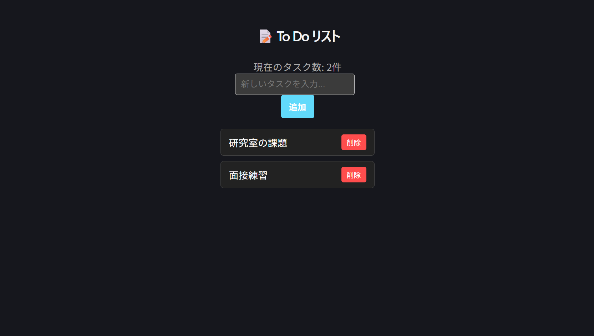

# react-study

React の基礎を学ぶために作成した、シンプルな **ToDo リストアプリ** です。
Vite + React 19 で構築し、`useState` / `useEffect` などの基本的な Hooks と、リスト描画・条件分岐といった React の基本パターンを一通り実践しています。

## 実装結果



> タスクを2件追加した状態の画面です（「研究室の課題」「面接練習」）。
> ダークテーマの画面に、入力フォーム・タスク数の表示・タスク一覧（削除ボタン付き）が表示されます。

## 機能

- **タスクの追加**：テキストを入力して「追加」ボタン（または Enter キー）で登録
- **タスクの削除**：各タスク右側の「削除」ボタンで個別に削除
- **タスク数の表示**：現在のタスク件数をリアルタイムで表示
- **空入力の防止**：空文字・空白のみの入力は追加されない
- **空状態の表示**：タスクが 0 件のときは「現在、タスクはありません。素晴らしい！✨」と表示
- **タブタイトルの連動**：ブラウザのタブ名が `タスク件数: N件` に自動で更新される

## 使用技術

| 区分 | 技術 |
| --- | --- |
| UI ライブラリ | [React](https://react.dev/) 19 |
| ビルドツール | [Vite](https://vite.dev/) 8 |
| Vite プラグイン | `@vitejs/plugin-react` |
| Lint | ESLint 10（`eslint-plugin-react-hooks` / `eslint-plugin-react-refresh`） |
| 言語 | JavaScript (JSX) |

## 学習ポイント

実装を通じて、主に次の内容を学びました（コードは [`src/App.jsx`](./src/App.jsx) にまとまっています）。

| 概念 | 使っている箇所 |
| --- | --- |
| `useState` による状態管理 | `todos`（タスク一覧）と `inputText`（入力中の文字列）を管理 |
| `useEffect` と依存配列 | `[todos]` を指定し、タスクが変わったときだけ `document.title` を更新 |
| 制御コンポーネント | `<input>` の `value` と `onChange` を state に紐付け |
| フォーム送信の制御 | `onSubmit` 内で `e.preventDefault()` を呼び、ページのリロードを防止 |
| イミュータブルな state 更新 | 追加はスプレッド構文 `[...todos, inputText]`、削除は `filter` で新しい配列を作成 |
| リスト描画 | `todos.map()` で `<li>` を生成し、`key` を付与 |
| 条件付きレンダリング | 三項演算子で「タスク 0 件」と「一覧表示」を切り替え |
| イベントハンドラ | `onClick={() => deleteTodo(index)}` で削除対象のインデックスを渡す |

## セットアップ

### 必要環境

- Node.js（Vite 8 が動作するバージョン。最新の LTS を推奨）
- npm

### インストールと起動

```bash
# リポジトリを取得
git clone https://github.com/ssoragit/react-study.git
cd react-study

# 依存パッケージをインストール
npm install

# 開発サーバーを起動
npm run dev
```

起動後、ターミナルに表示される URL（通常は `http://localhost:5173`）をブラウザで開いてください。

### 利用可能なスクリプト

| コマンド | 内容 |
| --- | --- |
| `npm run dev` | 開発サーバーを起動（HMR 対応） |
| `npm run build` | 本番用にビルド（`dist/` に出力） |
| `npm run preview` | ビルド結果をローカルで確認 |
| `npm run lint` | ESLint でコードをチェック |

## ディレクトリ構成

```
react-study/
├── public/            # 静的ファイル（favicon など）
├── src/
│   ├── assets/        # 画像・SVG
│   ├── App.jsx        # ToDo アプリ本体
│   ├── App.css        # （Vite テンプレート由来・現在は未使用）
│   ├── index.css      # グローバルスタイル
│   └── main.jsx       # エントリーポイント
├── index.html
├── vite.config.js
├── eslint.config.js
├── package.json
└── todolist.png       # 実装結果のスクリーンショット
```

## 今後の改善アイデア

学習用のため、あえてシンプルな実装にしています。今後は次のような改善に取り組む予定です。

- [ ] タスクごとに一意な `id` を持たせ、`key` にインデックスではなく `id` を使う
- [ ] タスクの完了／未完了の切り替え（チェックボックス・取り消し線）
- [ ] タスクの編集機能
- [ ] `localStorage` による保存（リロードしても消えないようにする）
- [ ] インラインスタイルを CSS ファイルへ分離し、コンポーネントを分割する
- [ ] フィルター機能（すべて / 未完了 / 完了）

## ライセンス

学習用リポジトリです。必要に応じてライセンスを追記してください。
